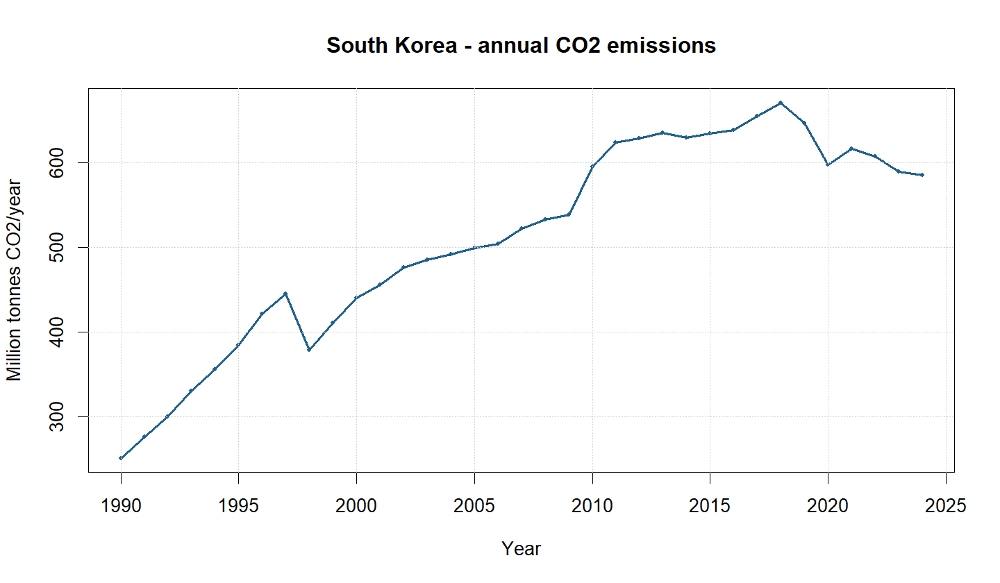
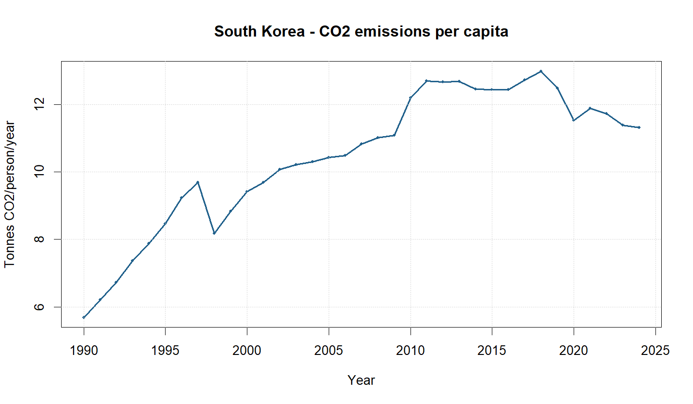
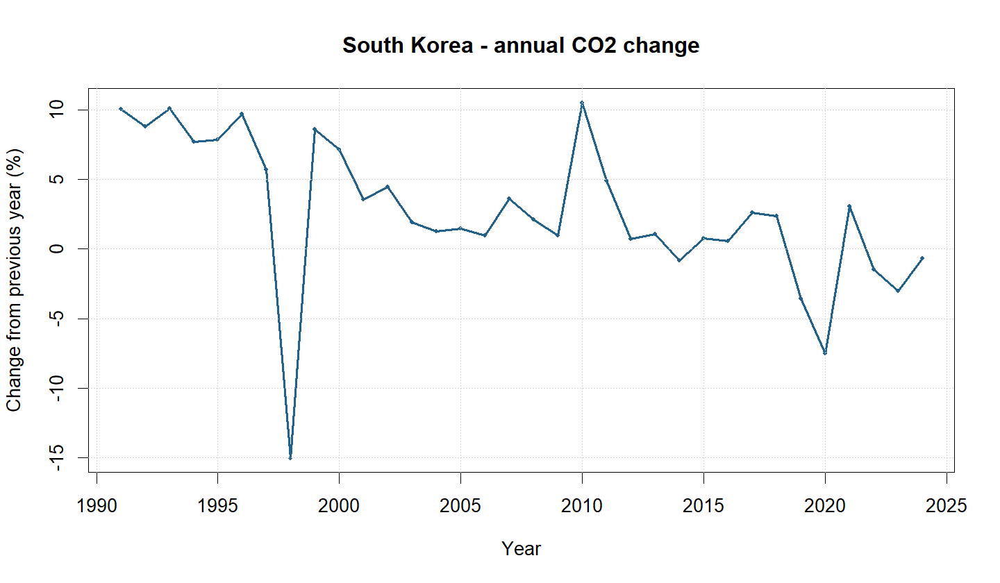

# CO2 Emissions Analysis: South Korea

**Student:** [Partosa, Alyssa Lou]
**Country / ISO-3:** South Korea / KOR
**Study period:** 1990 to 2024
**Declared to instructor on:** [Mr. Abner Buco]

## Research Question

How have annual CO2 emissions and per-capita emissions changed in South Korea from 1990 to 2024?

## Data Source and Definitions

Source: Our World in Data (OWID), CO2 and Greenhouse Gas Emissions dataset.
Dataset: https://github.com/owid/co2-data
Downloaded on: November 14, 2026.

Variables used:
- year: Year of observation.
- co2: Annual fossil-fuel and industrial CO2 emissions, measured in million tonnes (Mt).
- co2_per_capita: Annual CO2 emissions per person, measured in tonnes per person.

The dataset uses territorial accounting. Land-use change emissions are excluded.

## How to Reproduce the Analysis

1. Install R, RStudio, and Git.
2. Open this repository as an RStudio Project.
3. Use an internet connection for the initial dataset download.
4. Run source("scripts/analyze_co2.R") in the RStudio Console.
5. Check the data/, figures/, and results/ folders.

## Results

- Earliest valid year: 1990 (250.51 Mt CO2).
- Latest valid year: 2024 (584.77 Mt CO2).
- Endpoint percentage change: +133.43%.
- Peak annual emissions: 2018 (670.17 Mt CO2).
- Latest per-capita emissions: 11.31 tonnes/person in 2024.

## Figures

## Interpretation (200-300 words)

South Korea's annual CO2 emissions generally increased from 1990 to 2018. Emissions rose from 250.51 million tonnes in 1990 to a peak of 670.17 million tonnes in 2018. This represents a substantial increase during the study period. By 2024, emissions had decreased to 584.77 million tonnes, which was still 133.43% higher than the 1990 level.

Per-capita emissions followed a similar pattern. They increased from 5.68 tonnes per person in 1990 to a peak of 12.98 tonnes in 2018, before declining to 11.31 tonnes in 2024. This shows that the changes were not only in total national emissions but also in the average emissions associated with each person.

An unusual decrease occurred in 1998, when annual emissions fell by approximately 15.04%. Another notable decline occurred in 2020, with a 7.53% decrease. These patterns are observations and do not establish their causes. The OECD identifies electricity generation and manufacturing, particularly industries using coal, as major sources of Korea's emissions. This provides useful context for understanding the country's long-term trend.

CO2 emissions matter because they contribute to climate change, which can affect temperature, rainfall, sea levels, habitats, and biodiversity. Therefore, monitoring national emissions is important for environmental protection and climate action. Although emissions declined after 2018, the 2024 value remained higher than the 1990 value.

## Limitations

This analysis uses territorial emissions, so emissions from imported products are counted in the country where they are produced rather than where they are consumed. Land-use change emissions are excluded. International aviation and shipping are not assigned to individual countries in this dataset. The analysis also covers CO2 rather than all greenhouse gases. Finally, the graphs show patterns over time but cannot prove that one event or activity caused a particular change.

## References

- Our World in Data. CO2 and Greenhouse Gas Emissions dataset. https://github.com/owid/co2-data
- Our World in Data. CO2 dataset: Sources and methods. https://ourworldindata.org/co2-dataset-sources
- OECD. (2024). OECD Economic Surveys: Korea 2024. https://www.oecd.org/en/publications/oecd-economic-surveys-korea-2024_c243e16a-en.html
- International Energy Agency. (2025). Korea 2025: Energy Policy Review. https://www.iea.org/reports/korea-2025
